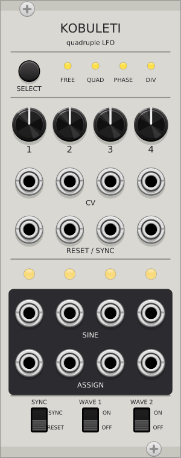

# Kobuleti

LFO quádruplo para VCV Rack 2 que roda o firmware aberto do **Xaoc Batumi** (MIT, Matthias Puech,
[github.com/poffy/batumi](https://github.com/poffy/batumi)).



## O que é do firmware e o que é novo

- `src/batumi/lfo.*`, `processor.*` e `resources.*` são cópias **sem alteração** do firmware. Eles
  rodam na taxa nativa do hardware, 16384 Hz, então frequências, curvas, sync, reset e divisões
  são as mesmas.
- `src/batumi/ui.*` é o `ui.cc` original adaptado: a fila de eventos, o debounce e a memória flash
  foram trocados por leitura direta do painel. A lógica dos botões, pots e LEDs não mudou.
- `src/batumi/drivers/*.h` substituem o ADC e o DAC do STM32 pelas portas do Rack.
- `src/Kobuleti.cpp` é o módulo do VCV: painel, escalas de tensão e salvamento no patch.

## Uso (igual ao Batumi)

- **SELECT**, toque curto: troca o modo (FREE → QUAD → PHASE → DIV) e zera o ajuste fino.
- **SELECT** segurado por 0,5 s: entra no ajuste fino (zoom). Os knobs passam a ajustar fino e o LED
  do modo pisca. Um toque curto sai; se um knob mudou durante o zoom, o LED pisca até o knob
  voltar à posição antiga.
- **SYNC/RESET**: define se as entradas RESET reiniciam a fase ou sincronizam o período.
- **WAVE 1/2**: escolhem a forma da saída ASSIGN: trapézio, rampa, serra ou triângulo.
- Nos modos QUAD, PHASE e DIV, o knob 1 controla a frequência e os knobs 2-4 controlam nível,
  fase ou divisão. Nesses modos o RESET 2 congela, o RESET 3 inverte a direção e o RESET 4 avança
  a forma de onda.

## Suposições sobre o hardware analógico

O firmware não define as tensões da parte analógica. Assumi entradas e saídas de ±5 V (fundo de
escala do ADC/DAC), CV de 1 V/oitava (confirmado nos testes) e gatilho de reset em ~3 V.

## Compilar e testar

```bash
make -j8 dist
```

O teste (`test/test.cpp`) confere a faixa de frequência, 1 V/oitava, quadratura (90°/180°),
divisões inteiras, reset e salvamento.
